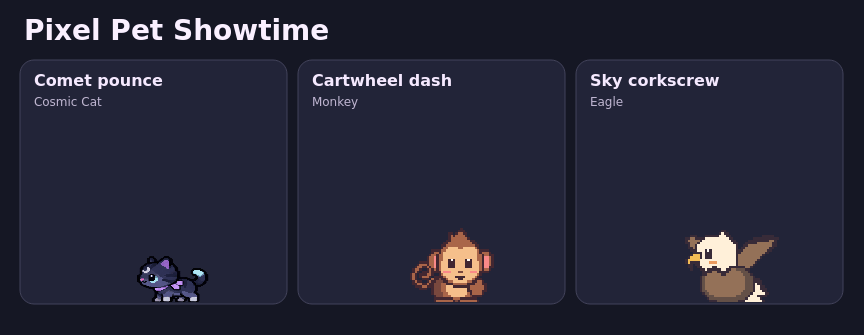

# Pixel Pet

Pixel Pet is a Linux desktop companion with animated animals, toys, a care card, and a focus timer. It sits behind app windows by default. The right-click menu includes an **Always on top** switch.

| Showtime | Take flight |
| --- | --- |
|  |  |

## Run locally

Pixel Pet uses Python and PySide6. It runs through X11 or XWayland, with window stacking tested on GNOME Wayland. For GNOME Wayland, make sure XWayland is installed and enabled.

```sh
git clone https://github.com/ScaraMouche-Wanderer/pixel-pet.git
cd pixel-pet
python3 -m venv .venv
. .venv/bin/activate
python -m pip install -r requirements.txt
./launch.sh
```

Pixel Pet keeps its settings and friendship progress in `~/.config/pixel-pet/settings.json`, or under `XDG_CONFIG_HOME` when set. **Start at login** in the right-click menu is opt-in.

## Play

- **Click** to pet, **hold** to cuddle, **double-click** to jump, and **drag** to reposition.
- **Middle-click** to open the care card, or **right-click** for the menu. Change your animal under **Choose pet** and its palette under **Style**.
- The cats prowl, stretch, groom, and chase yarn. Monkey climbs, swings, and cartwheels. **Eagle** and **Dusk Owl** use different wingbeats and return to perch after a flight.
- Use **Showtime** for a signature move, **Take flight** for either bird, or **Animate** for specific poses. Turn **Autonomous play** off to control when they move.
- Try **Firefly hunt** for a short desktop game or **Focus together** for a 15-, 25-, or 50-minute timer. Linux systems with `notify-send` also show a notification at the end of a focus session.
- **Play pace** sets the speed, and **Motion effects** controls the dust, leaves, and feather trails. Trails and speech bubbles pass input through to the apps underneath.

## Source and artwork

The repository includes the original Cosmic and Classic Cat sprite sheets. Monkey, Eagle, and Dusk Owl are drawn in code in `animals.py`. The two demos use these characters. The app can also load compatible optional sprites from the local `assets` directory, which are outside the shipped artwork.

```sh
python -m unittest -v test_pet test_companion
python pet.py --preview preview
```
