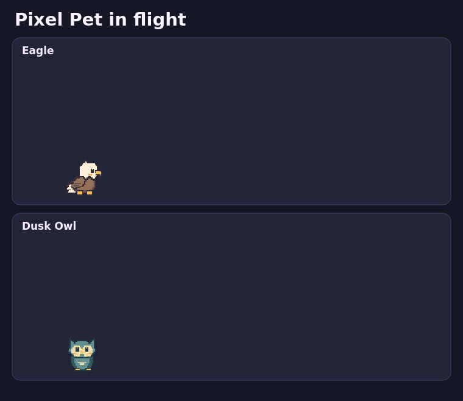

# Pixel Pet

Pixel Pet is a Linux desktop companion with animated animals, toys, a care card, and a focus timer. It sits behind app windows by default. Turn on **Always on top** under **Settings** to keep the pet visible above them.

| Showtime | Take flight |
| --- | --- |
|  |  |

## Run locally

Pixel Pet uses Python and PySide6. It runs through X11 or XWayland, with window stacking tested on GNOME Wayland. For GNOME Wayland, make sure XWayland is installed and enabled.

```sh
git clone https://github.com/ScaraMouche-Wanderer/pixel-pet.git
cd pixel-pet
python3 -m venv .venv
. .venv/bin/activate
python -m pip install -r requirements.txt
./launch.sh
```

Pixel Pet keeps its settings and friendship progress in `~/.config/pixel-pet/settings.json`, or under `XDG_CONFIG_HOME` when set. **Start at login** in **Settings** is opt-in.

## Controls

- **Right-click the pet** to see **Hide** and **Show menu**. Move onto the buttons to use them, or move away to dismiss them. Choose **Hide** to put the pet away. Click the tray icon or run the launcher again to bring it back.
- **Show menu** opens a compact, zoo-themed controls window with a live habitat preview. Move the pointer outside the zoo window or choose **Close** to dismiss it. You can also press **Esc** or switch windows to dismiss either menu. The tray menu also offers **Show menu**.
- **Appearance** lets you pick Cosmic Cat, Classic Cat, Monkey, Eagle, or Dusk Owl. Set **Colour**, **Size**, and **Speed** in the same tab. The bundled pets offer Original, Pastel, and Moonlight palettes.
- **Hold** to cuddle, **double-click** to jump, **drag** to reposition, or **middle-click** to open the care card. For a head pat, use **Pet** in the care card.

## Play

In **Play → Animate**, each pet has four exclusive moves. With **Autonomous play** enabled, your pet performs them automatically in shuffled rounds during idle time. **Motion effects** adds animated props, including Seedy’s falling leaves and fruit when its sprite is installed.

- The cats prowl, stretch, groom, and chase yarn. Monkey climbs, swings, and cartwheels. **Eagle** and **Dusk Owl** use different wingbeats and return to perch after a flight.
- In **Play**, use **Showtime** for a signature move, **Take flight** for either bird, or **Animate** for specific poses. Turn **Autonomous play** off in **Settings** to control when they move.
- In **Play**, try **Firefly hunt** for a short desktop game or **Focus together** for a 15-, 25-, or 50-minute timer. Linux systems with `notify-send` also show a notification at the end of a focus session.
- **Motion effects** in **Settings** controls dust, leaves, and feather trails. Trails and speech bubbles pass input through to the apps underneath.

## Source and artwork

The repository includes the original Cosmic and Classic Cat sprite sheets. Monkey, Eagle, and Dusk Owl are drawn in code in `animals.py`. The two demos use these characters. The app can also load compatible optional sprites from the local `assets` directory, which are outside the shipped artwork.

```sh
python -m unittest -v test_pet test_companion
python pet.py --preview preview
```
